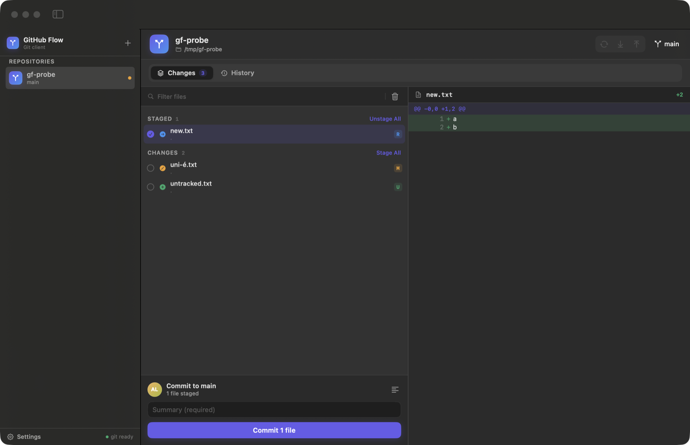
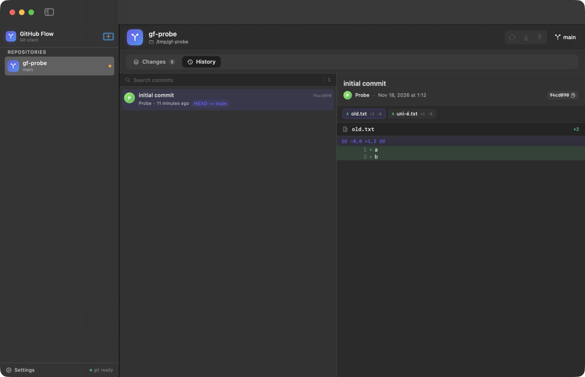

# GitHub Flow

A native macOS Git client built with **SwiftUI** and **Swift 6** (strict
concurrency), inspired by GitHub Desktop but with a calmer, more polished
interface.

The app drives the real `git` command line under the hood — no bundled libgit2,
no shell scripts, no hidden state. Everything you see comes from `git status`,
`git log`, `git diff`, and friends.





## What makes it different

- **Flow Center** — a dedicated tab that treats the branch as a unit of work.
  It scores readiness against a base branch, checks commits ahead/behind,
  drift, conflict risk (via a trial merge), branch age, review size, and
  uncommitted work. The impact map groups changed files into code, tests,
  docs, config, dependencies, migrations, CI, and assets, and flags secrets,
  large diffs, and binary changes. It also generates a copy-ready pull request
  title and description, plus an *Open Pull Request Page* link derived from the
  remote URL (no GitHub account or API token required).
- **Safety Net** — destructive actions become reversible. Before a discard,
  undo, amend, revert, merge, cherry-pick, or branch delete, the app captures a
  hidden snapshot under `refs/githubflow/…`. The Safety tab lists snapshots
  with a one-click restore, and restoring is itself snapshotted first.
- **Command palette** — `⌘K` opens a fuzzy palette for every action, tab,
  repository, and branch.
- **Standup digest** — aggregates commits across all tracked repositories for
  today or the past week and copies a Markdown summary. Local-only and private.
- **Repository janitor** — finds merged or stale branches, large blobs in
  history, and common missing `.gitignore` entries, with safe cleanup actions.
- **Explain changes** — generates an offline review narrative for a branch or
  commit using file grouping and risk heuristics. On macOS 26+ it can optionally
  refine the result with Apple’s on-device Foundation Models; the code never
  leaves the Mac either way.

## Features

- **Repository sidebar** — add existing repositories, clone from a URL or path,
  or create a new repository. The recently used repository is restored on
  launch.
- **Changes tab**
  - Staged and unstaged change groups with per-file stage/unstage checkboxes.
  - Stage all / unstage all, discard a single file or every change (with
    confirmation).
  - Side-by-side file list and unified diff viewer with line numbers, hunk
    headers, addition/deletion counts, and binary-file handling.
  - Commit composer with summary + optional description, live "N files staged"
    status, and `⌘↩` to commit. When a name/email is set in Settings it overrides
    the repository's git config for commits.
  - Automatic refresh every few seconds so changes made in other tools appear
    without a manual reload.
- **History tab**
  - Commit list with avatars, relative dates, merge indicator, and ref badges.
  - Commit detail with full message, author/date, copyable SHA, per-file chips,
    and a diff viewer for the selected file.
  - Revert a commit (guarded by a confirmation dialog).
  - Instant search across subjects, authors, and SHAs.
- **Stashes tab** — save tracked and untracked changes with an optional message,
  browse saved stashes, apply or pop them, and permanently drop a stash with
  confirmation.
- **Branches** — switch local or remote branches (remote branches create a
  tracking branch), create a branch with or without switching to it, and manage
  branches in one place: merge another branch into the current one, rename a
  branch, or delete it (with confirmation).
- **Commit actions** — amend the latest commit (edit its message and/or include
  more staged changes), undo the latest commit while keeping its changes staged,
  cherry-pick any commit onto the current branch, and revert commits.
- **Remotes** — add, edit, or remove remotes from a dedicated sheet. A repository
  without a remote shows an *Add Remote…* button in the header so it can be
  published afterwards.
- **Sync** — fetch, pull, push, with ahead/behind badges and a one-click
  *Publish* for branches that have no upstream yet.
- **Native details** — light/dark/automatic appearance, keyboard shortcuts,
  Finder/Terminal integration, conflict and in-progress-operation banners
  (merge, rebase, cherry-pick, revert), and an app icon.

## Requirements

- macOS 14 or later
- Xcode 16 or later (the project uses Swift 6 language mode with complete
  concurrency checking)
- `git` available at `/usr/bin/git` or via Homebrew

## Build & run

Open `GitHubFlow.xcodeproj` in Xcode, select the **GitHubFlow** scheme, and
press Run. The scheme builds both the app and the `GitHubFlowTests` test bundle
and is checked in under `xcshareddata`, so it is available to everyone.

To build or test from the command line:

```sh
# Build the app
xcodebuild -project GitHubFlow.xcodeproj -scheme GitHubFlow -configuration Debug build

# Run the test suite (parsers + a live temporary repository)
xcodebuild -project GitHubFlow.xcodeproj -scheme GitHubFlow test
```

To produce a distributable `.app` bundle (ad-hoc signed, includes the icon and
generated Info.plist):

```sh
sh scripts/build-app.sh
open .build/GitHubFlow.app
```

Regenerate the app icon after tweaking `scripts/make-icon.swift`:

```sh
sh scripts/make-icon.sh
```

## Keyboard shortcuts

| Action | Shortcut |
| --- | --- |
| Add existing repository | `⌘O` |
| Clone repository | `⇧⌘O` |
| New repository | `⇧⌘N` |
| Command palette | `⌘K` |
| New branch | `⇧⌘B` |
| Refresh | `⌘R` |
| Fetch / Pull / Push | `⇧⌘F` / `⇧⌘P` / `⌥⌘P` |
| Commit staged changes | `⌘↩` |

## Project layout

```
GitHubFlow.xcodeproj/   Xcode project (shared GitHubFlow scheme)
GitHubFlow/
  App/            App entry point, menu commands, AppKit delegate
  Core/           ProcessRunner, GitClient (actor), parsers for status/log/diff
  Models/         Domain types, AppModel (single source of truth), persistence
  Design/         Theme, reusable buttons, avatars, pills, empty states
  Views/          Sidebar, welcome, repository header, changes, history, diff,
                  sheets, settings
  Assets.xcassets App icon (all macOS icon sizes)
  Info.plist      Extra keys merged into the generated Info.plist
GitHubFlowTests/
                  Parser unit tests + end-to-end GitClient tests
scripts/          App bundle, icon generation
docs/             Screenshots
```

The app and test targets use Xcode's file-system synchronized groups, so any
file added under `GitHubFlow/` or `GitHubFlowTests/` is picked up automatically
— no project-file edits or code-generation step required.

### Versioning

The bundle version comes from the target's build settings, so it can be edited
in Xcode under **General → Identity** (Version / Build) or under **Build
Settings** (`MARKETING_VERSION`, `CURRENT_PROJECT_VERSION`). `Info.plist` only
holds extra keys that Xcode does not generate (automatic and sudden termination).

### Concurrency model

- `GitClient` is an `actor`; every git invocation is serialized.
- `ProcessRunner` bridges `Process` to `async` with a lock-protected
  termination box and concurrent pipe draining, so it never blocks a
  cooperative thread and can't deadlock on large output.
- `AppModel` is `@MainActor @Observable` and owns all UI state; views read it
  from the environment. Generation tokens make sure a slow diff/commit fetch
  can never overwrite a newer selection.

## Notes & limitations

- Authentication is delegated to git's credential helpers. For HTTPS private
  repositories configure e.g. `git config --global credential.helper osxkeychain`.
  Interactive terminal prompts are disabled so the app never hangs.
- History loads the most recent 200 commits.
- Staging is per file (no line-level partial staging).
- Stash saves include untracked files by default.
- Hosting-specific API features (pull request creation, issues, Actions) remain
  out of scope. The Flow Center opens the provider’s compare page in your browser
  and generates the PR copy locally instead of calling an API.
- Safety snapshots live in the repository under `refs/githubflow/…`; they are
  never pushed and can be deleted from the Safety tab.
- The on-device explanation refinement requires macOS 26 or later. The offline
  narrative works on every supported macOS version.
- A repository without a remote won't show a *Publish* button — open *Manage
  Remotes…* (or use `git remote add origin …`) first.
- Merges and cherry-picks that conflict leave the repository in the corresponding
  in-progress state; resolve the marked files in the Changes tab and commit to
  finish.
- Git LFS and signing are passed through to your git configuration; commits are
  created unsigned by default so no pinentry prompt blocks the app.
